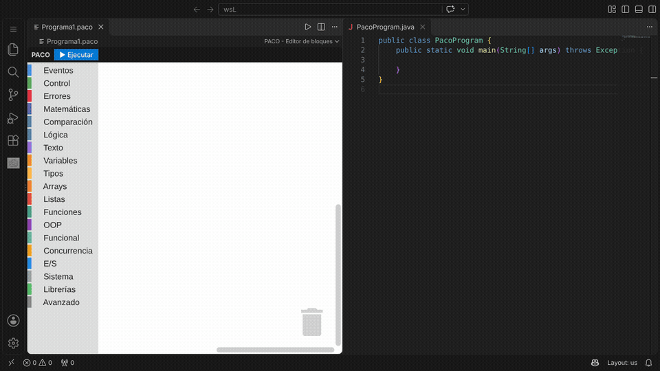

# PACO - Editor visual de Java

**PACO** (Programming Adapter for Code Overlay) es una extensión de Visual Studio Code para aprender Java con bloques estilo Scratch. Cada bloque que colocas se traduce al instante en código Java que compila, y con un clic puedes ejecutarlo.

Hecho por **Francisco Solano Žderić**.



## Qué hace

- Editor de bloques basado en Blockly, integrado en VS Code y en español.
- Java en tiempo real: cada cambio en los bloques actualiza el código Java de la derecha.
- Botón **▶ Ejecutar**: compila y ejecuta el programa en un terminal, así que también puede leer del teclado.
- Los programas se guardan como archivos `.paco`. Si tienes una carpeta abierta, cada programa nuevo se crea en ella como `ProgramaN.paco`; al abrir un `.paco` aparecen sus bloques, y `Ctrl+S` los guarda.
- Cubre Java de un curso completo: control de flujo, variables y tipos, arrays, colecciones, funciones, clases, interfaces, herencia, excepciones, concurrencia, lambdas y streams, entrada y salida, y Java moderno (`record`, clases e interfaces `sealed`, `switch` con flechas, `var`...).
- Si unos bloques no se pueden traducir, el editor lo avisa en vez de dejar el Java viejo sin decir nada.

## Cómo se usa

1. Haz clic en el icono de PACO en la barra de actividad (a la izquierda).
2. Pulsa **Abrir Editor PACO**. También puedes ejecutar `PACO: Abrir Editor Visual de Java` desde la paleta de comandos (`Ctrl+Shift+P`), o abrir cualquier archivo `.paco`.
3. Arrastra bloques desde el menú de la izquierda, empezando por **cuando bandera verde presionada**.
4. Pulsa **▶ Ejecutar** (o el botón ▷ de la barra del editor) para ver lo que hace tu programa.

## Requisitos

- Visual Studio Code 1.100 o superior.
- Para ejecutar los programas, un JDK 17 o superior (por ejemplo [Eclipse Temurin 21](https://adoptium.net/)). Si PACO no encuentra Java, te ofrece descargarlo.

---

## English

PACO is a VS Code extension for learning Java with Scratch-style blocks. Every block you place is translated in real time into compilable Java, and the **▶ Ejecutar** (Run) button compiles and runs it in a terminal. Programs are saved as `.paco` files. Running programs requires JDK 17 or later. The interface is in Spanish.

---

## Desarrollo

### Compilar y probar

```
npm install
npm run compile
npm test
```

Pulsa `F5` en VS Code para abrir una ventana de desarrollo con la extensión cargada. `npm test` ejecuta los tests del generador de Java; si hay un `javac` en el PATH, también comprueba que el Java generado compila.

### Generar el paquete para el Marketplace (.vsix)

El Marketplace no acepta el código fuente: hay que subir un archivo `.vsix`.

```
npm install
npm run vsix
```

Eso crea `paco-<versión>.vsix` en la carpeta del proyecto. Para probarlo antes de publicarlo: en VS Code, `Extensiones` → `...` → `Instalar desde VSIX...`.

### Publicar una versión nueva

1. Sube el número de `version` en `package.json` y añade la entrada en `CHANGELOG.md`.
2. Genera el `.vsix` con `npm run vsix`.
3. Súbelo en [marketplace.visualstudio.com/manage](https://marketplace.visualstudio.com/manage/publishers/FranciscoSZ) (publisher `FranciscoSZ`) con **Update** sobre PACO. También se puede hacer con `npx vsce publish` y un token personal de Azure DevOps.

### Añadir un bloque nuevo

1. Define el bloque en `media/index.js` y añádelo al toolbox del mismo archivo.
2. Añade su caso en el parser `src/core/scratch/xmlToIr.ts`.
3. Si necesita un nodo IR nuevo, añade su interfaz en `src/core/ir/nodes.ts`.
4. Añade el caso que genera Java en `src/core/java/irToJava.ts`.
5. Añade un test en `src/test/unit/`.

---

## Autor

Francisco Solano Žderić
GitHub: https://github.com/PakoPakete
VS Marketplace: https://marketplace.visualstudio.com/publishers/FranciscoSZ

## Licencia

MIT - 2025 Francisco Solano Žderić
