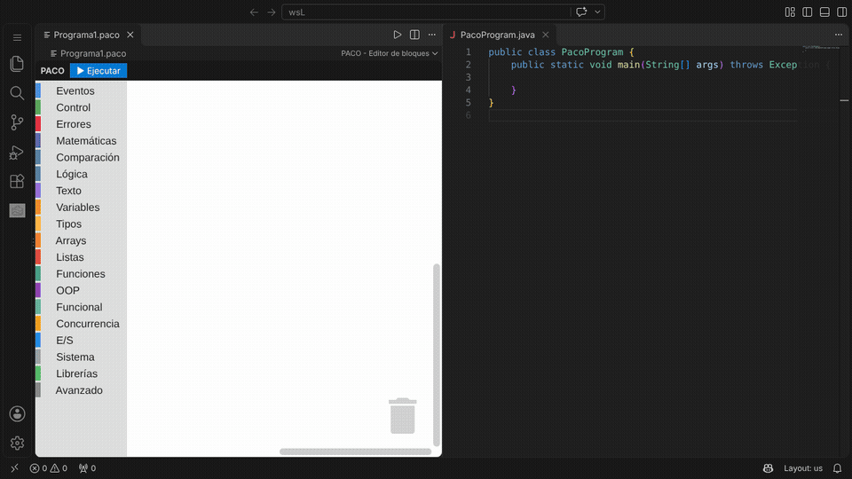
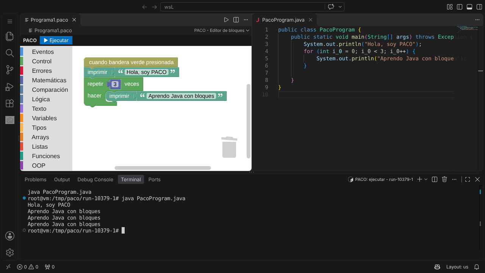
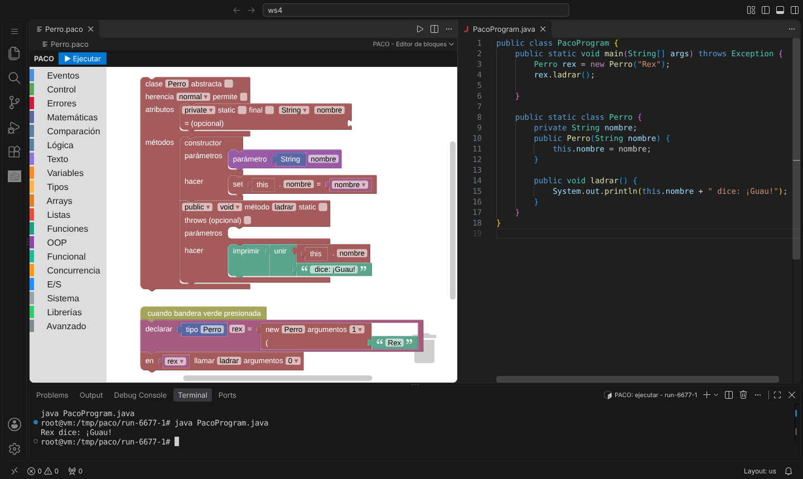

<p align="center">
  
</p>

<h1 align="center">PACO: aprende Java con bloques</h1>

<p align="center">
  Arrastra bloques como en Scratch y mira cómo se convierten en <b>Java real</b> al instante, dentro de VS Code.<br>
  Un clic en <b>▶ Ejecutar</b> y tu programa corre.
</p>

<p align="center">
  <a href="https://marketplace.visualstudio.com/items?itemName=FranciscoSZ.paco"></a>
  <a href="https://marketplace.visualstudio.com/items?itemName=FranciscoSZ.paco"></a>
  <a href="https://marketplace.visualstudio.com/items?itemName=FranciscoSZ.paco&ssr=false#review-details"></a>
  <a href="https://github.com/PakoPakete/paco/actions/workflows/test.yml"></a>
  <a href="LICENSE"></a>
</p>

<p align="center">
  
</p>

## ¿Por qué PACO?

Aprender Java suele empezar peleándose con llaves, puntos y comas y mensajes de error. PACO le da la vuelta: primero entiendes **la idea** con bloques que encajan, y a la vez ves **el Java de verdad** que esa idea produce.

- 🧩 **Bloques que encajan**: si dos piezas no tienen sentido juntas, no encajan. Nada de errores de sintaxis.
- ☕ **Java real, no un juguete**: el código de la derecha es Java estándar que compila con `javac`. Puedes copiarlo, estudiarlo y llevártelo a cualquier proyecto.
- ⚡ **En tiempo real**: cada bloque que mueves actualiza el Java al momento, así ves qué línea sale de cada pieza.
- ▶️ **Ejecutar con un clic**: compila y ejecuta en el terminal de VS Code, también programas que leen del teclado.
- 🇪🇸 **Todo en español**: los bloques, los menús y los avisos.
- 🎓 **De cero a un curso completo**: empieza con "imprimir" y llega hasta clases, herencia, colecciones, lambdas, streams e hilos.

## Empieza en un minuto

1. Instala PACO desde el Marketplace (o busca **PACO** en la vista de Extensiones de VS Code).
2. Haz clic en el icono de PACO en la barra de actividad, a la izquierda, y pulsa **Abrir Editor PACO**.
3. Arrastra el bloque **cuando bandera verde presionada** y mete dentro un **imprimir**.
4. Pulsa **▶ Ejecutar**. ¡Ya has escrito tu primer programa en Java!

> Para ejecutar programas necesitas un JDK 17 o superior. Si PACO no encuentra Java, te ofrece descargarlo ([Eclipse Temurin](https://adoptium.net/) es gratis).

## De bloques a Java

Así se ve el ejemplo del GIF: a la izquierda los bloques, a la derecha lo que PACO escribe por ti.

<p align="center">
  
</p>

```java
public class PacoProgram {
    public static void main(String[] args) throws Exception {
        System.out.println("Hola, soy PACO");
        for (int i_0 = 0; i_0 < 3; i_0++) {
            System.out.println("Aprendo Java con bloques");
        }
    }
}
```

## Todo lo que puedes construir

| Categoría | Lo que aprendes |
| --- | --- |
| **Control** | `if`/`else`, `while`, `do-while`, `for`, for-each, `switch` (también con flechas), `break` y `continue` |
| **Variables y tipos** | `int`, `double`, `long`, `char`, `boolean`, `String`, constantes, `var`, casting |
| **Texto y matemáticas** | `printf`, métodos de `String`, funciones de `Math`, conversiones, operadores de bits |
| **Arrays y listas** | arrays 1D y 2D, `ArrayList`, `LinkedList`, `HashSet`, `TreeSet`, `HashMap`, `Stack`, `ArrayDeque`, `Arrays` y `Collections` |
| **Funciones** | parámetros, valores de retorno, genéricos, varargs, `throws` |
| **Objetos (OOP)** | clases, constructores, atributos, `this`, `super`, herencia, interfaces, clases abstractas, `enum`, `record`, clases `sealed`, clases internas y anónimas |
| **Errores** | `try`/`catch`/`finally`, multi-catch, `throw` |
| **Funcional** | lambdas, referencias a métodos, streams (`filter`, `map`, `sorted`, suma, media...), `Optional` |
| **Concurrencia** | hilos, `synchronized`, `ExecutorService`, `AtomicInteger` |
| **Entrada y salida** | leer del teclado con `Scanner`, archivos, URLs, fechas con `LocalDate` |

### Ejemplo: tu primera clase

Una clase `Perro` con su atributo, su constructor y un método, y un `main` que crea un perro y lo hace ladrar. Los bloques de *OOP* se encargan de las llaves, de `this` y de `public static class`.

<p align="center">
  
</p>

## Programas en varios archivos

Cuando un programa crece, lo puedes repartir. Pon tus clases en `Figuras.paco` y, desde otro programa de la misma carpeta, usa el bloque **usar archivo** (en *Librerías*). PACO junta las clases, funciones y constantes en el Java generado, y si cambias `Figuras.paco`, los programas que lo usan se actualizan solos.

Cada programa se guarda como un archivo `.paco`: ábrelo y aparecen sus bloques, pulsa `Ctrl+S` y se guardan. Así puedes entregarlos, compartirlos o subirlos a Git como cualquier otro archivo.

## Para docentes

- Los alumnos ven a la vez el concepto (bloques) y la sintaxis (Java), y pueden pasar a escribir Java a mano cuando estén listos.
- El Java generado es de solo lectura y PACO se encarga de que compile, así que la clase se centra en la lógica y no en los puntos y comas.
- Funciona sin conexión: Blockly, los iconos y los sonidos van incluidos en la extensión.
- Gratis y de código abierto (MIT).

## Requisitos

- Visual Studio Code 1.100 o superior.
- Para ejecutar los programas, un JDK 17 o superior. Para crear bloques y ver el Java no hace falta.

## Preguntas frecuentes

**¿Puedo editar el Java que genera PACO?**
El archivo `PacoProgram.java` es de solo lectura porque siempre refleja los bloques. Si quieres seguir a mano, copia el código a un archivo `.java` nuevo.

**No pasa nada al pulsar ▶ Ejecutar.**
Comprueba que tienes un JDK instalado (`java -version` en un terminal). Si los bloques no se pueden traducir, el editor muestra un aviso y el detalle aparece en el panel *Salida* → *PACO*.

**¿Dónde se guardan mis programas?**
Si tienes una carpeta abierta, cada programa nuevo se crea en ella como `ProgramaN.paco`.

**Encontré un error o quiero un bloque nuevo.**
¡Genial! Abre un [issue en GitHub](https://github.com/PakoPakete/paco/issues) contando qué pasó o qué bloque te gustaría.

## Novedades

La versión 0.5.0 trae el botón **▶ Ejecutar**, programas guardados como `.paco`, programas en varios archivos, más de cien bloques nuevos (Java moderno, colecciones, streams, OOP completo) y muchos arreglos para que el Java generado compile. Todos los detalles en el [CHANGELOG](CHANGELOG.md).

---

## English

**PACO lets you learn Java with Scratch-style blocks inside VS Code.** Every block you place is turned into real, compilable Java in real time, side by side, and the **▶ Ejecutar** (Run) button compiles and runs it in the integrated terminal, keyboard input included.

- Covers a full Java course: control flow, types, arrays, collections, methods, classes, inheritance, interfaces, exceptions, lambdas, streams, concurrency and modern Java (`record`, `sealed`, switch expressions, `var`).
- Programs are saved as `.paco` files, and one program can use the classes and functions of another with the **usar archivo** (use file) block.
- Works offline. Running programs requires JDK 17 or later.
- The blocks and the interface are in Spanish.

---

## Contribuir

PACO es código abierto. Para compilarlo, ejecutar los tests, añadir bloques o generar el `.vsix`, mira [CONTRIBUTING.md](CONTRIBUTING.md).

## Autor

Hecho por **Francisco Solano Žderić** · [GitHub](https://github.com/PakoPakete) · [Marketplace](https://marketplace.visualstudio.com/publishers/FranciscoSZ)

Si PACO te sirve, deja una ⭐ en [GitHub](https://github.com/PakoPakete/paco) o una [reseña en el Marketplace](https://marketplace.visualstudio.com/items?itemName=FranciscoSZ.paco&ssr=false#review-details). Ayuda a que más gente lo encuentre.

## Licencia

[MIT](LICENSE) · 2025 Francisco Solano Žderić
